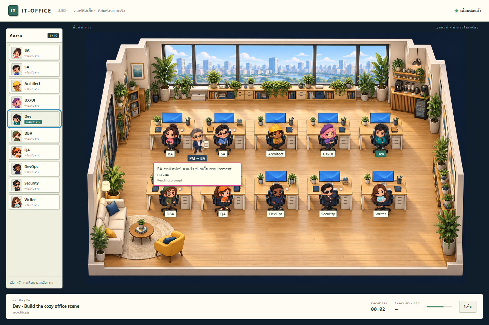

# Cozy office 2.5D — v1.0.0

The default browser and VS Code scene now use a fixed-camera room image and an alpha-transparent character atlas generated with GPT through the built-in image generation tool. All assets are local; runtime requires neither WebGL nor a generation API key.

## What changed

- `packages/core/public/office.js`: HTML roster, characters, PM briefing, activity inspector and task HUD.
- `office.css`: cream/wood office UI, small-panel and narrow-screen layouts, reduced-motion support.
- `office-model.js`: presentation work transitions and PM walking/briefing, separated for tests. Keeps the original initial-snapshot suppression, Thinking suppression, changed-work assignments, completion praise, Writer wrap-up, three-item pending queue, 1.3-second handover and 2.8-second briefing. Walking uses image coordinates and clear aisles.
- `office-data.js`: original ten role IDs, colors, titles and Thai/English dialogue.
- `assets/office-cozy-v1.png`: generated room, 1536 × 1024.
- `assets/team-chibi-v1.png`: generated 4 × 3 transparent character atlas, ten workers plus PM. Exact generation prompts are in `assets/README.md`.
- `index.html`: selects the new scene by default. `?view=3d` retains access to the original renderer for comparison.
- The static server recognizes PNG content type. No hook, event, role classification, token counting, permission, workspace restriction or extension command behavior changed.

The screenshot reference's chat, provider switching and quest submission were not added: this remains the existing read-only Claude Code activity viewer. The waiting-for-approval state directs the user back to Claude Code. The extension's own reset action remains available; the duplicate in-page reset is hidden in embed mode.

## Preview

From `packages/core`, run `npm run demo -- --no-open` and open the URL printed by the demo. It uses synthetic events. Add `?lang=th` for Thai, `?embed&lang=th` for the extension layout, or `?view=3d` for the previous scene.

The release VSIX is `vscode/claude-code-3d-1.0.0.vsix`. Install it with **Extensions: Install from VSIX...**. Version 1.0.0 retains the extension ID, increments scene compatibility to 3 and replaces an older background server when the office next starts. In-memory task counters restart once during that upgrade; Claude Code work is unaffected. Marketplace publication is a separate manual step by the maintainer.

## Verification

- Core: `cd packages/core && npm test` — 30 tests, including planner, PM handover/queue/reset, real reducer transitions and static asset delivery.
- VS Code: `cd vscode && npm test` — 14 tests.
- Browser: `node scripts/office-smoke.mjs` using an existing Playwright installation and Chrome. Set `PLAYWRIGHT_MODULE_PATH` to `playwright/index.mjs` if Playwright is outside the project. No browser-test dependency was added.
- Browser checks cover 10 roles, zero WebGL canvases, PM briefing, activity, failures, approval, task completion, reset, session selection, 960 × 450 embed view, 390 × 844 mobile view, reduced motion, and no page errors.
- JavaScript syntax and `git diff --check` pass. There is no separate lint, type-check or application build command in this JavaScript project.

The browser checks exercise the embedded page layout; an installed VS Code webview and real Claude Code session still require a manual check after installing the release.

The room and characters are fixed-view painted sprites. Animation uses movement, bobbing and status labels rather than a skeletal 3D rig. Very small panels shrink the room; the roster scrolls so all ten roles remain reachable.
